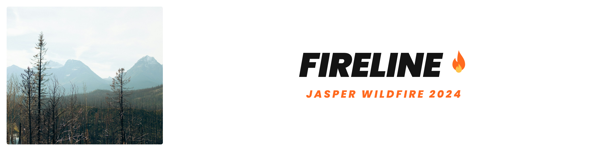

<div align="center">
  <br />
    <a href="#">
      
    </a>
  <br />

  <div>
    
    
    
    
    
    
    
  </div>

  <h3 align="center">Fireline: Jasper 2024</h3>

   <div align="center">
A 3D story of the July 2024 Jasper wildfire, built from satellite imagery: what the valley looked like before, how fast the fire ran, how badly it burned, and which buildings stood closest to it.
    </div>
</div>
<br/>

**Dataset(s)** 🗃️
- [Sentinel-2 Level-2A imagery](https://registry.opendata.aws/sentinel-2-l2a-cogs/) (Copernicus / ESA, via Earth Search on AWS)
- [Copernicus GLO-30 elevation model](https://registry.opendata.aws/copernicus-dem/)
- [National Burned Area Composite 2024](https://cwfis.cfs.nrcan.gc.ca/datamart/metadata/nbac) and [fire hotspots](https://cwfis.cfs.nrcan.gc.ca/downloads/hotspots/) (Natural Resources Canada, CWFIS)
- [OpenStreetMap](https://www.openstreetmap.org/copyright) buildings, roads and rail

## What's in it
- **The valley**: about 43 × 46 km of the Athabasca valley as a 3D block, with every clear Sentinel-2 pass from July to September in true colour or infrared.
- **The run**: the 22–24 July timeline, a replay of 2,868 satellite heat detections in the order they were recorded, and a burn severity map.
- **The town**: Jasper at Sentinel-2's full 10 m resolution, with each mapped building coloured by its distance to burned ground.

## How it works
Burn is measured with the Normalized Burn Ratio, `NBR = (NIR − SWIR) / (NIR + SWIR)`. A median of six clear passes before the fire is compared with a median of four after it (dNBR), cloud and shadow are masked with the Sentinel-2 scene classification, and the standard FIREMON severity breaks are applied.

The satellite estimate of the burned area is **302 km²**. The official mapped perimeter is **316 km²**.

The project runs in three stages:
1. **`analysis.ipynb`**: the exploration. It downloads the data and works out the method: choosing usable passes, building the burn index, picking the threshold, validating against the official perimeter (93% overlap), the hotspot timeline, and why the town chapter measures exposure rather than damage.
2. **`pipeline/`**: the settled method as scripts that build the files the app loads, in `data/` (about 5 MB).
3. **The web app**: plain HTML, CSS and an ES module (`main.js`), with three.js vendored in `vendor/`. No build step.

## Setup & Installation
**Prerequisites**

Ensure the following are installed;
- [Git](https://git-scm.com/)
- [Python 3.10+](https://www.python.org/downloads/) (for the notebook and pipeline)
- [Jupyter Notebook](https://jupyter.org/install) (or install the Jupyter extension on [Visual Studio Code](https://code.visualstudio.com/)) to open `analysis.ipynb`

<br/>
To set up this project locally, follow these steps:

1. Clone the repository:
```shell
git clone https://github.com/thebugged/jasper-fireline.git
```

2. Change into the project directory:
```shell
cd jasper-fireline
```

3. Install the required dependencies (only needed for the notebook and pipeline):
```shell
pip install -r requirements.txt
```
<br/>

## Running the application
1. The page loads its data with `fetch`, so serve it rather than opening `index.html` directly:
```shell
python3 -m http.server 8000
```
The application will be available in your browser at http://localhost:8000.

2. To see how the data was analysed, open and run `analysis.ipynb` (downloads ~400 MB into `data_raw/` on first run, about 10 minutes).

3. To rebuild the app's data from scratch:
```shell
cd pipeline
python cwfis.py   # fire hotspots and the official perimeter
python s2.py      # Sentinel-2 passes onto one grid
python dem.py     # elevation
python osm.py     # buildings, roads, rail
python town.py    # 10 m close-up of the townsite
python build.py   # indices, textures and data/story.json
```


## Limits
- The main grid is ~42 m per pixel, so single buildings only show in the 10 m town close-up.
- Distance to burned ground measures exposure, not damage. Roofs barely change the burn index, so destroyed houses aren't detected directly.
- Heat detections are only recorded when a satellite passes over, so the replay has gaps.

<br/>

Banner photo by [Katherina Lipatnikova](https://unsplash.com/photos/burnt-trees-before-snow-capped-mountains-CJCSI0rQJxc) on Unsplash.
